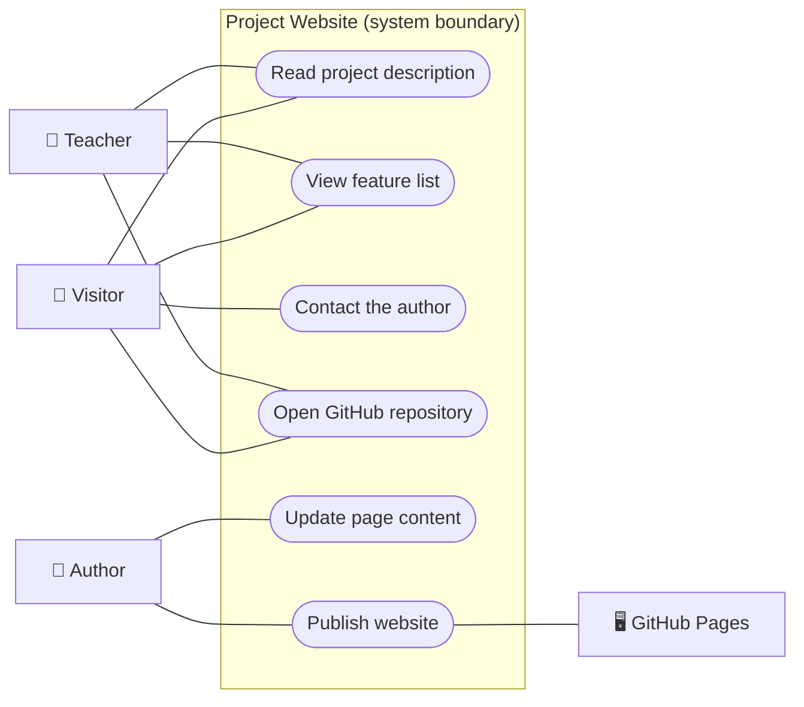

# project-website

Project Website is a small one-page website that presents a student project for the IT Fundamentals course at Vistula University. It shows what the project is, which features it has and how to contact the author. It will be used by classmates, the teacher and other visitors who want to learn about the project. It solves a simple problem: all key information about the project is in one place that anyone can open in a browser, without downloading files.

## About the project

This repository contains a small static website written in HTML and CSS. I use it to practise the basic Git and GitHub workflow: every change is made on its own branch, sent to GitHub and merged into `main` through a pull request. The website is published online with GitHub Pages, so each merged change is visible on the live page.

## How to view the page

Open the live website here: [https://fatihalkan79731.github.io/project-website/](https://fatihalkan79731.github.io/project-website/)

You can also download the repository and open `index.html` in any web browser.

## User stories

**Story 1**

> As a visitor, I want to read a short description of the project on the home page, so that I quickly understand what the project is about.

- [ ] The description is visible at the top of the page without scrolling on a computer.
- [ ] The description has no more than 3 sentences.

**Story 2**

> As a teacher, I want to open the GitHub repository from the website, so that I can check the code and the commit history.

- [ ] The page has a link to the GitHub repository.
- [ ] The link opens the correct repository page on github.com.

**Story 3**

> As a visitor, I want to see the author's contact information, so that I can send a question or an idea about the project.

- [ ] The page has a "Contact" section with an email address.
- [ ] Clicking the email address opens a new email in the visitor's mail program.

## Actors

- **Visitor** – a person (for example a classmate) who opens the website to learn about the project and to contact the author.
- **Teacher** – the course teacher who opens the website and the repository to check and grade the project.
- **Author (site owner)** – the student who updates the content of the website through branches and pull requests.
- **GitHub Pages** – an external system that publishes the newest version of the website from the `main` branch.

## Use cases

| Use case | Actor(s) |
|---|---|
| Read project description | Visitor, Teacher |
| View feature list | Visitor, Teacher |
| Contact the author | Visitor |
| Open GitHub repository | Teacher, Visitor |
| Update page content | Author |
| Publish website | Author, GitHub Pages |

## Use case diagram

*Simplified use case diagram — actor nodes = stick persons, oval nodes = use cases.*

## Planned features (Product Backlog)

1. Project description at the top of the page
2. List of the main features of the project
3. Contact section with an email address
4. Link to the GitHub repository
5. Layout that works well on mobile phones
6. Navigation menu with links to every section
7. Screenshot gallery of the project
8. Dark mode switch

## Author

Fatih Alkan · Student ID 79731
